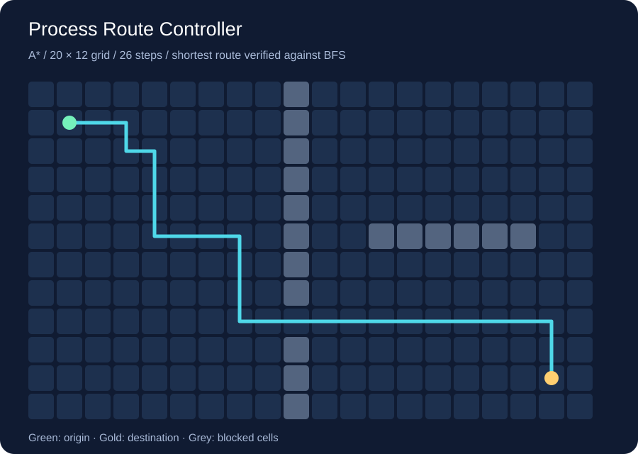

# Process Route Controller

C++20 controller for a Windows grid process: cross-process memory reads, shortest-path navigation, state transitions and WinAPI input.



## Components

- **route-world.exe** — native Win32 window with a 20 × 12 map, obstacles, current position, health and buffer counters. Publishes a root address for its own state through a temporary startup handshake.
- **route-controller.exe** — launches the world, opens it with `PROCESS_VM_READ | PROCESS_QUERY_LIMITED_INFORMATION`, reads the root pointer and state with `ReadProcessMemory`, verifies protocol/sequence consistency and computes routes with A*.
- **route-tests** — portable C++ tests, including comparison against independent BFS on 200 seeded maps, route legality, unreachable goals, threshold boundaries, return/unload, stall recovery and invalid snapshots.
- **route-report** — writes an SVG of the computed route. The image above is generated by this executable, not a Windows screenshot.

The controller reads state from the other process's actual address space. It does not use screen capture, OCR, OpenCV or pixel matching.

## Windows: unpack and run

Download `ProcessRouteController-win-x64.zip` from Releases, extract the entire folder and start **route-controller.exe**. Keep both executables beside each other. No installation, .NET or Qt runtime is required; the MSVC runtime is linked statically.

Keep the world window focused. Moving focus away pauses navigation input while health monitoring continues. **Escape** stops the controller and closes its child process.

| Key in the world window | Action |
|---|---|
| `Space` | Fill the buffer; the controller returns to origin, performs Ctrl+click and resumes navigation |
| `H` | Switch health between 100% and 34%; the low-health state triggers child-window closure |
| `R` | Move state into a different heap allocation; the controller follows the new root pointer |
| `B` | Toggle an obstacle next to the starting point |
| `S` | Freeze/unfreeze movement to exercise no-progress detection |

Route inputs use `ClientToScreen`, virtual-desktop absolute coordinates and `SendInput`. Before input, the controller verifies both the target window's process ID and foreground ownership. Input pacing varies between 100 and 180 ms. State monitoring is independent of that pacing, with a nominal 10 ms poll; actual response time depends on Windows scheduling and target message handling. Zero-latency or hard real-time guarantees are not provided.

## Build

Windows x64, Visual Studio 2022 C++ tools and CMake:

```powershell
cmake -S . -B build -A x64
cmake --build build --config Release --parallel
ctest --test-dir build -C Release --output-on-failure
.\build\Release\route-controller.exe
```

macOS / Linux — planner, state machine, tests and route report:

```sh
cmake -S . -B build -DCMAKE_BUILD_TYPE=Release
cmake --build build --parallel
ctest --test-dir build --output-on-failure
./build/route-report docs/route.svg
```

The Windows process and input adapters use WinAPI and do not run natively on macOS. A Windows machine or VM is needed for the complete controller.

## Verification

GitHub Actions builds and tests on Windows, macOS and Linux. Windows additionally runs `route-controller --integration-test`, launching a real child process and checking remote reads, relocation, obstacle changes, navigation, return/unload and emergency closure. Its deterministic input delivery uses window messages to the owned window; the interactive `SendInput` desktop path requires a normal interactive Windows session and is not covered by that integration test.

## Integration boundaries

- Only the process launched by this controller is supported. No arbitrary PID attachment or memory modification is exposed.
- Root discovery uses the startup handshake; this is not an automatic reverse-engineering or offset-discovery tool. `R` verifies following an already-known root after a heap relocation, not recovering undocumented offsets after a software update.
- The fixed protocol is in `src/core.hpp`. Supporting another application's layout requires a separate adapter, version checks and validation against that application.
- Emergency handling posts `WM_CLOSE` to the owned child. Job-object cleanup ensures that child does not remain after controller exit. TCP disconnection and kernel drivers are not implemented.
- Stall handling replans and reports no progress; it does not invent a route through blocked or frozen movement.

The repository contains no third-party application offsets or external service credentials.
